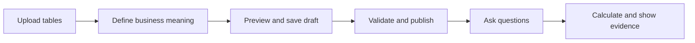

# Conversational AI Bot

Turn business tables into answers using definitions you can review, publish and inspect.

Conversational AI Bot is a local analytics assistant for CSV and Excel data. It lets you define what business terms mean through chat, review the proposed changes, and ask questions using published definitions.

## Why we are building it

A table contains values but does not explain business rules. Does revenue include refunds? Should cancelled orders count? How should sales and inventory be combined?

This project makes those decisions explicit and reusable. Analysts and business teams can maintain consistent definitions and inspect the calculation, source and model version behind each answer.

## Features

- Import UTF-8 CSV and single-sheet XLSX files; profile types, missing values and candidate keys.
- Define metrics, column descriptions, exclusions, grain and relationships through conversational edits.
- Preview exact changes and validation reports before saving a new draft.
- Choose available views and publish reviewed definitions.
- Ask aggregate questions across one or two related views.
- Inspect result tables, parameterized SQL, source timestamps and warnings.
- Browse versions, restore earlier definitions and retrieve saved answers.
- Register independently checked expected answers to detect future regressions.

## How it works



Uploaded rows and business definitions remain separate. An edit creates a draft; questions keep using the published model until you publish again. The interpreter produces structured operations or query plans, which the backend validates before execution.

## Example: sales and inventory

Create a project and choose **Try sample data** on Data sources. In Semantic model, use **Edit with AI** to preview and save each instruction:

```text
Define revenue as amount minus refund in sales.
Exclude cancelled orders from sales.
Set grain of sales to one row per order.
Link sales.product_id to inventory.product_id as many_to_one.
```

Open Agent setup, review the assumptions and checks, acknowledge them, then publish. In Chat, ask:

```text
Show sales.revenue and inventory.total_stock by sales.product_id.
```

| Product | Revenue | Stock |
|---|---:|---:|
| P001 | 290 | 12 |
| P002 | 75 | 3 |
| P003 | 50 | 8 |
| P004 | null | 15 |

Revenue totals **415** after refunds and cancellation exclusions. Metrics are aggregated before merging, preventing repeated sales rows from duplicating stock. Missing matches remain null rather than becoming zero.

## Run locally

Requirements: Python 3.11+ (3.12 recommended), Node.js 24 and npm. Installation needs internet access; demo mode needs no model credentials.

```bash
git clone https://github.com/bodhi12496/Conversational_AI_Bot.git
cd Conversational_AI_Bot
python3 -m venv .venv
source .venv/bin/activate
python -m pip install --require-hashes -r requirements.lock
python -m pip install --no-deps -e .
cd frontend
npm ci
npm run build
cd ..
python -m uvicorn app.main:create_app --factory --host 127.0.0.1 --port 8000
```

Open http://127.0.0.1:8000. On Windows, activate with `.venv\Scripts\activate`.

Alternatively, run `docker compose up --build` and open the same address. Compose persists data in a named volume.

For frontend development, leave the backend running and run `npm run dev` inside frontend, then use the printed Vite URL. Production frontend assets are generated by the build command.

## Interpreter modes

**Demo (default):** an offline parser supporting specific patterns, including the examples above. Unsupported wording returns clarification. Each question is independent.

**Amazon Bedrock:** interprets broader natural language using AWS Converse, returning the same validated operations and query plans.

```bash
export COE_PROVIDER=bedrock
export AWS_REGION=us-east-1
export BEDROCK_MODEL_ID='YOUR_MODEL_OR_INFERENCE_PROFILE_ID'
export AWS_PROFILE='YOUR_LOCAL_PROFILE'
python -m uvicorn app.main:create_app --factory --host 127.0.0.1 --port 8000
```

Use an enabled tool-capable model and credentials from the normal AWS SDK credential chain. Calls are billable. Model metadata and request text are sent to Bedrock; uploaded raw rows are not. Native startup reads exported variables and does not automatically load .env. See [.env.example](.env.example).

## Technology

| Area | Tools |
|---|---|
| Interface | React, TypeScript, Vite |
| API | Python, FastAPI |
| Validation | Pydantic contracts and deterministic service checks |
| Storage and calculations | SQLite, immutable model snapshots, bounded SQL compilation |
| Interpretation | Offline parser or AWS Bedrock |
| Verification | Pytest, Vitest, optional Playwright |

The interface has six pages: Overview, Data sources, Semantic model, Agent setup, Chat, and Activity & versions.

## Development checks

```bash
python -m pytest -q
python -m ruff check backend scripts
python -m ruff format --check backend scripts
python scripts/verify_local.py --dom
```

The integration runner starts a temporary backend and checks the API and UI with synthetic data. For real-browser checks, install Playwright and Chromium and run `python scripts/verify_local.py`.

API documentation: http://127.0.0.1:8000/api/docs while the server runs.

## Current scope

This is a **single-owner local prototype**. It supports sum, average, count, distinct count, minimum and maximum, arithmetic using +, − and *, one grouping column, and at most two queried views linked through a confirmed relationship.

Multi-user authentication/RBAC, live database connections, automatic synchronization, arbitrary SQL, document RAG, forecasting, ranking and multi-hop joins are not implemented. Grain and fiscal-calendar settings are metadata. Calculations use SQLite INTEGER/REAL rather than exact-decimal accounting.

Keep the server bound to loopback. The optional COE_API_TOKEN protects the workspace as a whole, not separate users or tenants. Local data defaults to var/platform.sqlite3 and is excluded from Git along with credentials, dependencies and the local code walkthrough.

## Documentation

- [Architecture](docs/ARCHITECTURE.md)
- [Semantic definitions and calculation rules](docs/SEMANTIC_LOGIC.md)
- [API examples](docs/API_EXAMPLES.md)
- [Scope and roadmap](docs/SCOPE_AND_NEXT_STEPS.md)
