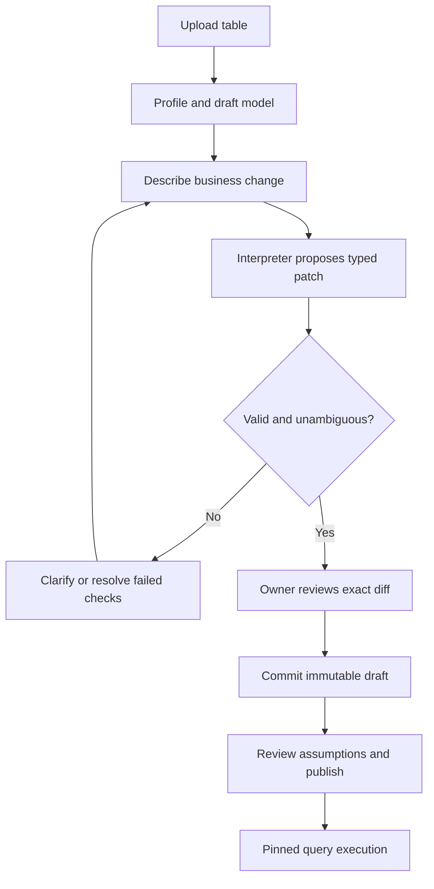

# Architecture and implementation decisions

## The working boundary

This repository implements the semantic foundation of the COE product. The original vision includes source connectors, multi-agent hosting, plugins and external information. Those features depend on a tested business-definition layer; they are subsequent milestones, not hidden implementations in this version.

The app runs as one process with a browser interface and persistent SQLite storage. It is a modular monolith: API, domain contracts, inference adapters, semantic services and persistence have distinct responsibilities without requiring a distributed deployment.

## Change flow

The same interpreter interface supports the offline parser and Bedrock. Neither can write directly to storage, alter permissions, run SQL or call other tools. The only output is a Pydantic-validated object. Server code determines the permissible operations and their effects.

## Where each responsibility lives

| Layer | Owns | Does not own |
|---|---|---|
| React client | User input, explicit edit/query mode, previews and release actions. | Semantic truth or access policy. |
| FastAPI routes | Request validation and lifecycle sequencing. | Free-form SQL execution. |
| Domain contracts | Versioned semantic JSON, operation union and logical query plans. | Database connections or inference credentials. |
| Interpreter | Translate wording into supported structured requests or clarification. | Applying changes, calculations or approval. |
| Change service | Copy a model, apply allowlisted operations, diff and validate. | Publishing an unreviewed result. |
| Validation service | Existing fields, expressions, filters, relationship invariants and reference answers. | Inferring proprietary business truth. |
| Composition compiler | Selected-view metric catalog, routing constraints and response instructions. | Security enforcement through prompts. |
| Query engine | Enforce selected views, compile SQL, calculate and merge results. | Arbitrary SQL or general Python. |
| Repository | Transactions, snapshots, versions, releases, proposals, runs and audit. | Multi-user authorisation. |

## Data model

`projects` holds the draft `head` and nullable published `active` version. `versions` stores immutable complete semantic snapshots. `datasets` records source ownership, source hash, import timestamp and row count; each import gets a generated physical table. These tables are immutable after ingestion in v0.1.

`proposals` stores the base version, typed changes, candidate snapshot, diff, validation result and status. `regressions` stores independently supplied logical plans and expected rows. `runs` stores the question, pinned semantic version and complete evidence-bearing result. `events` supplies a local audit trail.

No source filename becomes executable SQL. Physical dataset names are generated. Normalized column identifiers pass a narrow identifier grammar; filter values are bound parameters.

## Concurrency

Inference runs outside the write transaction. A proposal can become stale while the model runs. Creating and applying it compare the requested base version with the current head.

Applying a change uses a SQLite `BEGIN IMMEDIATE` transaction. The base check, validation, new immutable version, head update and proposal status commit together. Concurrent proposals against one base cannot both succeed.

Publishing only points `active` at the currently reviewed head after revalidation. A question first reads the active model snapshot and keeps that version for its complete run even if another version is published during inference. Uploaded source tables are immutable, so data cannot drift during these local runs.

Rollback copies a historical model into a new draft after current reference tests run. It never deletes history or silently changes the active pointer.

## Query execution

For one view: resolve qualified metric names → enforce selection → compile safe expressions and filters → execute parameterized aggregates → return results and evidence.

For two views: require a confirmed, unambiguous direct relationship; require grouping by its key; aggregate each metric on its own source; merge group results in application memory. Raw fact tables are never joined. A source-only key remains visible through the full outer merge. Null relationship keys and incompatible declared cardinality fail validation.

The engine refuses unsupported scope rather than substituting another question. It supports at most eight metrics, 500 groups before merging, one grouping column and two queried views. It refuses oversized groups before combining them, avoiding an answer based on partial source results. An explicit result limit can truncate the final table, which is labelled.

## Why the initial stack is smaller than the production plan

FastAPI/Pydantic and the Bedrock boundary follow the proposed production direction. SQLite gives a reproducible local setup, atomic revisions and actual persisted source tables with no cloud account. React/Vite supplies a typed browser client without a second server-side rendering layer. A synchronous, bounded workflow makes the initial semantics observable.

PostgreSQL/RLS, warehouse adapters, durable queues, S3, workers, OIDC and tracing should be introduced with concrete multi-user, throughput and source-freshness requirements. Adding LangGraph or another agent framework does not replace any of the semantic validation implemented here.
